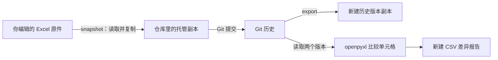

# 快速上手项目指导

这个项目可以理解为：**给 Excel 加一个“保存版本、找回旧版、查看改动”的工具。** 你仍然用 Excel 编辑文件，Python 负责组织操作，Git 保存历史，openpyxl 负责理解单元格内容。

本文按“实际怎么用 → 内部怎么运行 → 关键代码为什么这样写”的顺序讲解。安装步骤和完整练习命令见 [README](README.md)。

## 1. 项目能帮你做什么

假设你有一份采购报表。第一天，采购数量是 3；第二天改成 4；第三天发现需要确认第一天的数据。这个工具支持以下操作：

| 你想做的事 | 对应命令 |
|---|---|
| 新建一个保存历史的文件夹 | `init` |
| 给当前 Excel 保存一个版本，并写说明 | `snapshot` |
| 查看这个文件有哪些历史版本 | `history` |
| 把某个旧版本取出来，保存为新文件 | `export` |
| 比较 Git 中的两个版本 | `diff` |
| 直接比较电脑上的两个 Excel 文件 | `compare` |

这里有个区别要先记住：**保存版本时保存整个文件的原始内容，比较版本时才读取里面的单元格。**



原件、托管副本和 Git 历史，是这个项目中三个不同的东西：

- **原件**：你平时用 Excel 打开、编辑的文件。
- **托管副本**：工具复制到版本库里的文件，代表最近一次保存的内容。
- **Git 历史**：历次已经提交的内容，保存在版本库的 `.git` 中。

下一次保存快照时，工具会更新干净的托管副本，原来的版本仍然留在 Git 历史里。

## 2. 源码怎样组织

项目的代码按职责分开，核心只有几个文件：

| 文件 | 负责什么 |
|---|---|
| [命令行入口 cli.py](excelgit/cli.py#L12) | 读懂你输入的命令，调用对应功能 |
| [版本管理 repository.py](excelgit/repository.py#L26) | 创建仓库、保存快照、读取历史、导出旧版 |
| [比较逻辑 compare.py](excelgit/compare.py#L21) | 读取工作表、比较单元格、生成报告 |
| [共用逻辑 common.py](excelgit/common.py#L7) | 定义错误类型、避免覆盖已有输出文件 |

这样拆分以后，“怎么比较两个工作簿”就不依赖“用户通过什么界面操作”。将来即使增加一个简单窗口，也可以继续调用现在的比较和版本管理代码。

## 3. 一条命令怎样进入程序

例如下面是一条保存快照的命令，其中路径只是示意：

```sh
python -m excelgit snapshot "/示例/采购报表.xlsx" --name "采购报表" -m "核对采购数量" --repo "/示例/版本库"
```

这些部分分别表示：

| 部分 | 含义 |
|---|---|
| `python -m excelgit` | 让 Python 运行这个包 |
| `snapshot` | 执行保存快照的操作 |
| `"/示例/采购报表.xlsx"` | 从哪里读取原文件 |
| `--name "采购报表"` | 在仓库中用什么名称管理这份工作簿 |
| `-m "核对采购数量"` | 这一次保存的说明 |
| `--repo "/示例/版本库"` | 把历史保存在哪个仓库 |

注意，**`--name` 是工作簿的稳定名称，`-m` 才是这一次版本的说明。**

同一份工作簿后续保存时，应该继续使用相同的 `--name`。否则，工具会把它当成另一个工作簿。

程序使用 Python 自带的 `argparse` 解析这些参数。比如：

```python
snapshot.add_argument("source", type=Path)
snapshot.add_argument("--name", required=True)
snapshot.add_argument("-m", "--message", required=True)
```

解析后，大致得到：

```python
args.source   # 原文件路径
args.name     # 采购报表
args.message  # 核对采购数量
args.repo     # 版本库路径
```

然后调用真正处理业务的代码：

```python
repo = Repository(args.repo)
commit = repo.snapshot(args.source, args.name, args.message)
```

所以，命令行这层的工作很简单：**接收参数、调用函数、显示结果。**

## 4. 创建版本库

创建版本库时，程序先建立一个受控的保存区域。

`Repository.init()` 主要做这些事：

1. 检查目标是不是新目录、空目录，或者已经由本工具创建的仓库。
2. 执行 `git init`。
3. 设置这个仓库自己的提交姓名和邮箱。
4. 创建工具识别标记和工作簿目录。
5. 提交一次初始化配置。

工具识别标记里现在只有：

```json
{"format": 1}
```

它让程序能够区分“这个工具的版本库”和你电脑上其他普通 Git 仓库。`format` 也为将来调整存储格式留下了一个简单的版本号。

初始化还会写入一条 Git 属性规则：

```text
workbooks/*.xlsx -text
```

它要求 Git 不对这些 Excel 文件做文本换行转换，因为我们需要保留文件原始字节。

初始化产生的第一次提交只包含配置。**工作簿要等你第一次执行 `snapshot` 后，才真正进入历史。**

## 5. 保存快照的完整流程

保存快照是整个项目最值得先读懂的流程。它在 `Repository.snapshot()` 中完成，可以按下面的顺序理解：

```text
读取原文件
    ↓
检查它能否作为 .xlsx 打开
    ↓
取得仓库锁
    ↓
检查仓库是否存在未提交修改
    ↓
与上一次托管副本比较原始字节
    ↓
更新托管副本
    ↓
git add
    ↓
git commit
    ↓
返回提交哈希
```

第一步读取的是文件字节：

```python
data = read_xlsx(source)
```

这里的 `data` 是一段 `bytes`。你可以把它理解为“这份文件完整的原始内容”。

随后用 openpyxl 打开并关闭，确认它能够被识别：

```python
book = open_workbook(data)
book.close()
```

**这里没有调用 `book.save()`。** 最终交给 Git 的仍然是刚才读到的原始字节。这样，工具保存快照时就不需要重新生成工作簿。

接着检查仓库状态：

```python
self.git("status", "--porcelain", "--untracked-files=all")
```

如果发现有人直接修改了托管副本，或者仓库里混入了未跟踪文件，程序就停止。因为此时继续替换文件，可能覆盖人工改动，也可能把不相关内容带入版本管理流程。

确认可以操作以后，会比较：

```python
if data == previous:
    return None
```

这表示“文件字节完全没有变化”，因此不用创建重复快照。

这里有一个容易混淆的地方：**文件字节相同，比单元格内容相同更严格。** Excel 重新保存文件后，即使你看见的单元格没变，内部其他信息也可能变化。因此，可能出现“产生了新快照，但单元格差异报告为空”的情况，两者并不矛盾。

更新托管副本后，真正保存历史的是：

```python
self.git("add", "--", relative)
self.git("commit", "--quiet", "-m", message, "--", relative)
```

可以把这两步理解为：

- `git add`：确定本次准备保存的文件内容。
- `git commit`：正式保存为一个历史节点，并附上说明。

最后：

```python
self.git("rev-parse", "HEAD")
```

取得最新提交的哈希。提交哈希相当于这个版本的精确地址。

## 6. Python 怎样调用 Git

项目没有使用专门的 Git Python 库，而是通过 `subprocess.run()` 调用电脑上已经安装的 Git。关键结构是：

```python
result = subprocess.run(
    ["git", "--literal-pathspecs", "-C", str(self.root),
     "-c", "commit.gpgsign=false", *args],
    capture_output=True,
    env=env,
    check=False,
)
```

先抓住三个部分：

- **参数列表**：把命令和每个参数分别传进去，文件名中的空格也能作为一个完整参数处理。
- **`-C`**：告诉 Git 在哪个仓库目录里工作。
- **`capture_output=True`**：让 Python 接住 Git 的正常输出和错误信息。

`result.returncode` 表示执行是否成功。返回码非零时，程序把 Git 的错误转成 `ExcelGitError`，再由命令行统一显示。

返回的 `result.stdout` 保持为字节，这一点很实用：查看历史时，它可以解码成文字；读取旧工作簿时，它就是需要导出的二进制文件内容。

## 7. 查看历史和导出旧版

查看历史和导出旧版，都建立在 Git 已经保存的内容上。

查看历史主要调用：

```python
self.git("log", "--format=%H%x00%aI%x00%s", "--", path)
```

其中：

| 标记 | 输出内容 |
|---|---|
| `%H` | 完整提交哈希 |
| `%aI` | 作者时间 |
| `%s` | 提交说明的第一行 |
| `%x00` | 用于分隔字段的空字符 |

程序再把每条记录整理成：

```python
Version(
    commit="某个提交哈希",
    date="提交时间",
    message="核对采购数量",
)
```

命令后面指定了文件路径，因此显示的是与这份工作簿有关的提交历史。

导出旧版时，程序先把你输入的哈希、`HEAD` 等版本表达式解析成一个明确的提交哈希，再读取：

```python
self.git("show", f"{commit}:{path}")
```

这里的含义是：从这个提交中，取出这个路径对应的文件内容。

它不会切换当前版本，也不会替换托管副本，只是读取历史内容，然后写入一个新文件。

还要注意：**`HEAD` 指向整个仓库的最新提交。** 如果仓库里管理多个工作簿，`HEAD~1` 不一定是你正在查看的工作簿的上一个版本。日常使用时，从 `history` 中复制具体哈希会更明确。

## 8. 把 Excel 转成可以比较的数据

比较器接收两份文件的字节：

```python
compare_workbooks(before, after)
```

它并不关心字节来自哪里：

- `diff` 从 Git 读取两个版本。
- `compare` 从磁盘读取两个文件。

后面的比较过程完全相同。这就是把“读取历史”和“比较内容”分开的好处。

openpyxl 的读取设置是：

```python
load_workbook(
    BytesIO(data),
    read_only=True,
    data_only=False,
)
```

`BytesIO(data)` 相当于把内存中的字节包装成一个可读取的文件。

`read_only=True` 用于读取工作簿；`data_only=False` 则让程序读到公式文本。例如：

```text
=B2*C2
```

这样，即使两条公式算出的结果相同，只要公式写法发生变化，比较器也能报告出来。**这个项目不负责计算公式结果。**

读取以后，`_contents()` 会把工作簿整理成类似下面的字典：

```python
{
    "采购": {
        "A1": CellValue("s", "品名"),
        "B2": CellValue("n", 3),
        "D2": CellValue("f", "=B2*C2"),
    }
}
```

这份结构分两层：

- 第一层用**工作表名称**定位表。
- 第二层用 **A1 坐标**定位单元格。

每个单元格同时记录类型和值：

```python
@dataclass(frozen=True)
class CellValue:
    kind: str
    value: object
```

`dataclass` 会帮助生成按字段比较是否相等的逻辑。这样比较时，既检查值，也检查类型：

| 内容 | 类型 |
|---|---|
| 数字 `1` | `n` |
| 文本 `"1"` | `s` |
| 布尔值 `TRUE` | `b` |
| 公式 `=1` | `f` |

这个设计避免把数字、文本数字和布尔值混为一谈。

空单元格则通过下面的判断跳过：

```python
if cell.value is None:
    continue
```

这里必须判断 `is None`。如果写成 `if not cell.value`，数字 `0` 和布尔值 `False` 也会被误认为空值。

## 9. 单元格比较算法

真正的比较算法，是“先对齐工作表，再对齐坐标”。

假设旧版本有：

```python
{
    "A1": "笔记本",
    "B2": 3,
    "C2": 12.5,
}
```

新版本有：

```python
{
    "A1": "笔记本",
    "B2": 4,
    "D2": "=B2*C2",
}
```

需要检查的坐标是：

```text
A1、B2、C2、D2
```

代码用两个集合的并集取得全部坐标：

```python
left.keys() | right.keys()
```

然后逐个判断：

| 旧版本 | 新版本 | 结果 |
|---|---|---|
| 有，且相同 | 有，且相同 | 不记录 |
| 没有 | 有 | 新增 |
| 有 | 没有 | 删除或清空 |
| 有 | 有，但内容不同 | 修改 |

因此，上面的例子会得到：

| 单元格 | 变化 | 旧值 | 新值 |
|---|---|---|---|
| B2 | 修改 | 3 | 4 |
| C2 | 删除 | 12.5 | 空 |
| D2 | 新增 | 空 | `=B2*C2` |

实际代码使用 `CellValue` 比较，所以还会考虑类型。每一条结果会保存为一个 `Change`：

```python
Change(
    sheet="采购",
    cell="B2",
    change="cell_changed",
    before=CellValue("n", 3),
    after=CellValue("n", 4),
)
```

有了这样的结构化结果，输出 CSV 就是把每个字段写成一列。将来增加 Excel 格式报告，也可以继续使用这份比较结果。

工作表新增或删除时，程序会先记录一条表级变化，再列出该表的非空单元格。因此，一个含有一个单元格的工作表被删除，会产生两条记录：删除工作表、删除那个单元格。

**它现在按名称和坐标匹配内容。** 所以插入一行可能引起很多坐标变化；工作表重命名会表现为删除旧表、增加新表。它还没有识别“同一条业务记录被移动”的能力。

## 10. 怎样保护原文件

文件保护逻辑，是这个小项目里很重要的一部分。

导出旧版和写差异报告都使用 `new_output()`。关键代码是：

```python
path.open("xb" if binary else "x", **options)
```

Python 的文件模式区别是：

| 模式 | 目标文件已经存在时 |
|---|---|
| `w` / `wb` | 会覆盖原内容 |
| `x` / `xb` | 创建失败，抛出异常 |

因此，用户误把导出路径写成原文件路径时，程序会拒绝覆盖。

保存快照还有两层保护：

第一层是仓库锁。一个快照正在保存时，另一个快照操作会停止，避免本工具的两个进程同时更新托管副本。

第二层是失败回滚。如果更新了托管副本，但 Git 提交失败，程序会尝试恢复原来的文件内容和暂存状态。如果暂存区恢复也失败，会明确报告，同时仍恢复托管文件。原始工作簿在整个过程中只被读取。

这些保护主要处理正常运行中的错误。突然断电、其他 Git 工具同时修改仓库等情况，仍然需要人工检查。

## 11. 测试验证了什么

本项目已经验证通过的 28 项测试，主要分成三类：

| 测试类别 | 验证内容 |
|---|---|
| 单元格比较 | 新增、删除、修改、公式、日期、类型差异、零与空值 |
| Git 版本管理 | 保存历史、顺序正确、导出内容一致、失败时保护文件 |
| 完整命令行流程 | 从创建仓库到快照、比较、导出，实际调用命令验证 |

例如，[提交失败回滚测试](tests/test_repository.py#L98)会故意让提交失败，再检查：

- 托管副本是否恢复为旧内容。
- 原文件是否仍是用户准备保存的新内容。
- 是否没有产生新提交。
- 仓库是否恢复为干净状态。

[类型比较测试](tests/test_compare.py#L38)则专门验证数字 `1`、文本 `"1"` 和布尔值 `TRUE` 能被区分。

这些测试使用内存生成的小工作簿和临时 Git 仓库，练习时不需要拿真实业务文件冒险。

从项目根目录执行：

```sh
python -m unittest discover -s tests -t . -v
```

## 12. 建议的源码阅读顺序

第一次读源码时，建议先跟着一次 `snapshot` 操作看：从 `cli.py` 的参数解析，进入 `Repository.snapshot()`，再进入 Git 调用。

理解这条路径后，再看 `_contents()` 如何整理工作簿，以及 `compare_workbooks()` 如何产生差异。仓库锁、回滚和 CSV 特殊字符处理，可以放到第二遍阅读。
